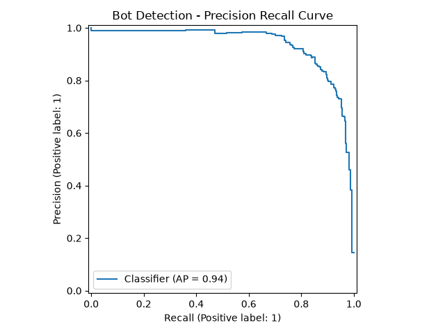
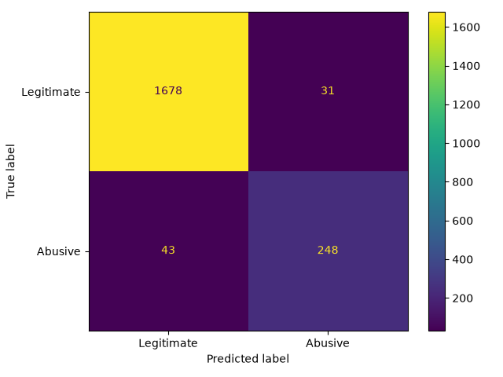

# Behavioral Bot Detection

An experimental machine learning pipeline for detecting abusive bots while protecting legitimate users and automated workloads.

## Features

- 10,000 synthetic traffic records
- Behavioral feature engineering
- Random Forest classification
- Isolation Forest anomaly detection
- Threshold optimization
- False-positive analysis

## Model Results

| Metric | Result |
|---|---:|
| Accuracy | 96% |
| Precision | 89% |
| Recall | 85% |
| F1-score | 87% |
| Average Precision | 93.74% |
| Overall False Positive Rate | 1.81% |
| Legitimate Automation False Positive Rate | 6.91% |

## Visualizations

## Installation

    python -m pip install -r requirements.txt

## Execution

    python -m src.generate_data
    python -m src.features
    python -m src.train
    python -m src.evaluate

## Testing

    python -m pytest tests/ -v

All 8 unit tests passed.

## Limitations

Results are based on synthetic data, not production traffic.
Reducing false positives for legitimate automation remains a challenge.

## Development

Personal project developed with AI-assisted coding, hands-on execution, testing and evaluation.

## License

MIT License.
